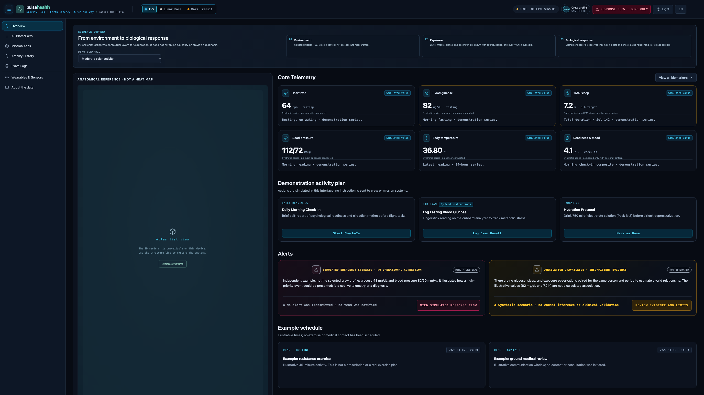
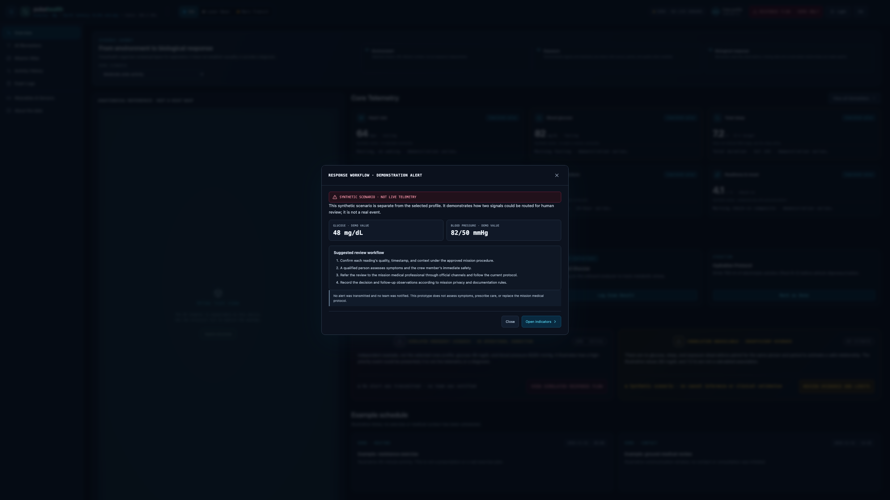
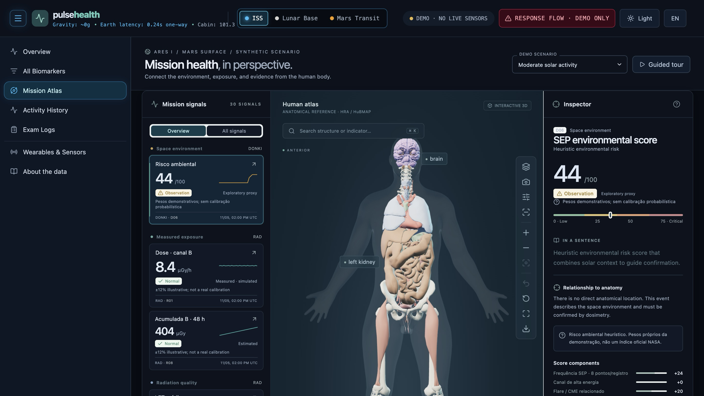
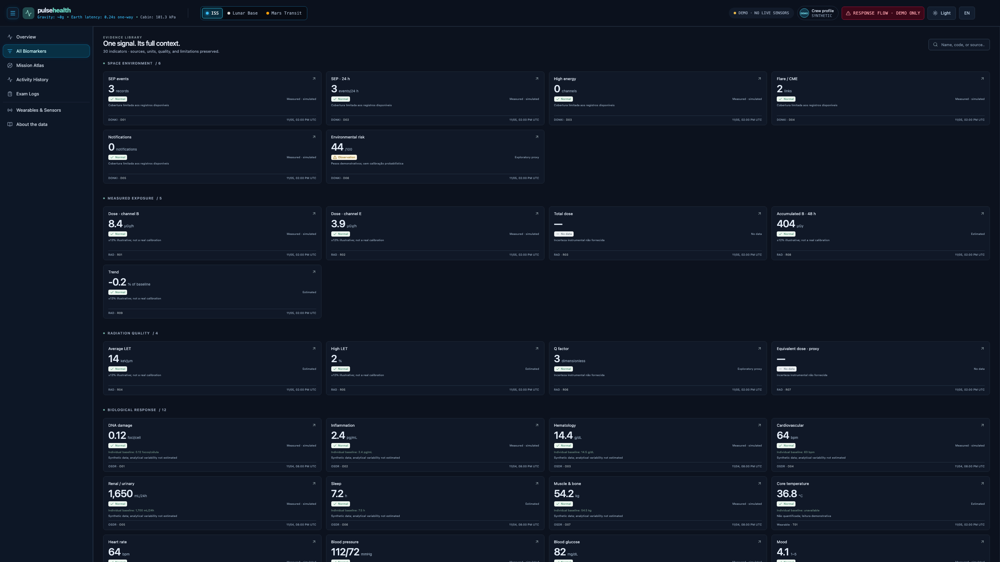
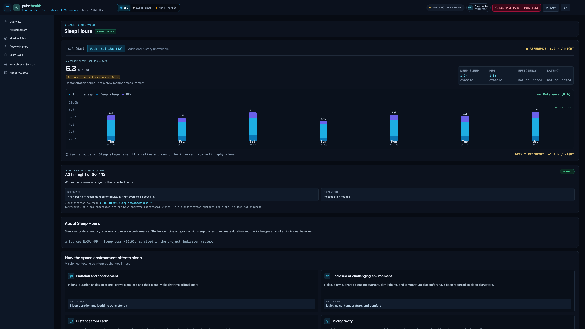
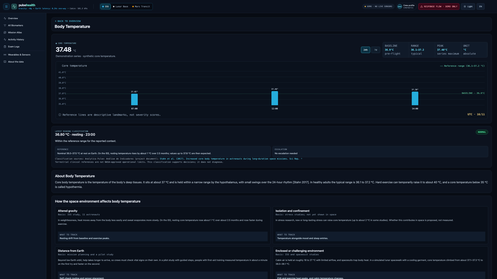
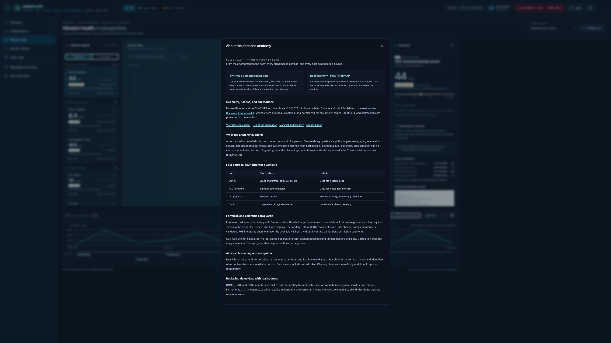

# PulseHealth

### Mission health evidence explorer

**NASA Space Apps Challenge 2026 · UFRJ Analytica**

**Live demo:** [pulse-production-d2524aac.up.railway.app](https://pulse-production-d2524aac.up.railway.app/)

PulseHealth is an interactive prototype for exploring how mission context, measured exposure, and biological observations can be reviewed together. It gives reviewers a shared place to inspect indicators, timelines, source context, and an anatomical reference while keeping missing data and scientific limits visible.

> **Demo status:** The interface is a research and presentation prototype. Its mission readings and scenarios are synthetic. It is not connected to a spacecraft, a wearable, a medical team, or a live NASA data feed. It does not diagnose, prescribe, or send operational alerts.

## The problem

Space-mission health analysis involves information with different meanings and time scales: space-environment events, measurements from exposure instruments, and biological observations collected in studies. Looking at these signals side by side can be useful, but treating them as synchronized evidence without checking source, timing, baseline, and missing data can suggest relationships that have not been established.

PulseHealth makes that evidence journey explicit:

1. **Environment** — What mission context or space-environment event is being explored?
2. **Exposure** — What did an instrument measure, when, and with what limitations?
3. **Biological response** — What biological observation is available, and how does it compare with its stated context or baseline?

The prototype organizes these layers for exploration. It does not claim that one caused another.

## What the prototype demonstrates

- **Highlights dashboard:** A mission overview, simulated biomarker readings, activity examples, and clearly labeled alert demonstrations.
- **Mission Atlas:** An interactive 3D anatomy reference alongside mission signals, evidence, and a timeline. Anatomy is for orientation; it does not map radiation dose or temperature to individual organs.
- **Indicator library:** 30 indicator definitions spanning environment, exposure, radiation quality, biological response, vital signs, and correlations. Each indicator has a source, unit, interpretation, and limitation.
- **Evidence states:** Missing, invalid, estimated, and unavailable observations are kept distinct; gaps are not silently treated as zero.
- **Dedicated biomarker pages:** Sleep-hours and body-temperature views show example time series and their context.
- **Presentation controls:** English and Brazilian Portuguese, dark and light themes, and 11 deterministic demonstration scenarios in the Mission Atlas.

## Suggested jury walkthrough

The most direct way to review the prototype is to follow the same sequence as the evidence model:

1. **Highlights** (`/en/highlights`) — Start with the three evidence layers and the synthetic-data notice. Review the example biomarker cards and alert explanations.
2. **Indicators** (`/en/indicators`) — Open the catalog and inspect how source, units, quality, and limitations accompany a signal.
3. **Mission Atlas** (`/en/mission-atlas`) — Choose a demonstration scenario, select a signal, and explore its context in the timeline and anatomy view.
4. **Sleep Hours** (`/en/highlights/biomarkers/sleep-hours`) or **Body Temperature** (`/en/highlights/biomarkers/body-temperature`) — Review an example longitudinal biomarker series. Total sleep duration is not treated as a sleep-stage measurement.
5. **About the data** (`/en/data-sources`) — Review the provenance, assumptions, and limitations behind the demonstration.

The same pages are available in Brazilian Portuguese by changing the language control.

## Screenshots

Store PNG captures in `screenshots/`. Each slot below names the route, the recommended framing, and the filename; the captures below show the English interface in its demonstration state.

### 1. Highlights overview

**Capture:** `/en/highlights`, at the top of the page, showing the evidence journey, anatomy reference, and core biomarker cards.

**Save as:** `screenshots/01-highlights-overview.png`



### 2. Simulated response flow

**Capture:** `/en/highlights`, with **View simulated response flow** open on the critical example. Keep the synthetic-scenario and no-notification explanation visible.

**Save as:** `screenshots/02-simulated-response-flow.png`



### 3. Mission Atlas

**Capture:** `/en/mission-atlas`, showing a selected signal, its evidence inspector, and the timeline. Choose a state that makes source and uncertainty legible.

**Save as:** `screenshots/03-mission-atlas.png`



### 4. Indicator library

**Capture:** `/en/indicators`, with the indicator categories and cards visible. Include source and status details if the viewport allows.

**Save as:** `screenshots/04-indicator-library.png`



### 5. Sleep Hours

**Capture:** `/en/highlights/biomarkers/sleep-hours`, with the time-series chart, period, and reference visible.

**Save as:** `screenshots/05-sleep-hours.png`



### 6. Body Temperature

**Capture:** `/en/highlights/biomarkers/body-temperature`, showing the example temperature series and its explanatory context.

**Save as:** `screenshots/06-body-temperature.png`



### 7. Data sources and limitations

**Capture:** `/en/data-sources`, showing source provenance and the scientific limitations of the prototype.

**Save as:** `screenshots/07-data-sources.png`



## Demo video

> **Video slot:** Add the public demo-video link here when the video is ready.

## Data, methods, and scientific limits

The application uses deterministic synthetic fixtures for the mission scenarios and biomarker readings. NASA and research datasets inform source semantics and adapter designs; their live records are not presented as real-time astronaut telemetry in this demo.

- **[NASA DONKI](https://ccmc.gsfc.nasa.gov/tools/DONKI/)** describes space-weather events. An event count or high-energy channel is not a measurement of a crew member's dose.
- **[NASA RAD](https://science.nasa.gov/mission/msl-curiosity/science-instruments/)** is a rover instrument reference for radiation exposure. It is not an astronaut-worn dosimeter, and rover measurements are not presented as personal crew exposure.
- **[NASA OSDR](https://osdr.nasa.gov/bio/repo/)** provides biological research data. Study samples are not live clinical monitoring.
- **[HRA / HuBMAP](https://humanatlas.io/3d-reference-library)** supplies the anatomical reference geometry used in the viewer. The mesh is not an individual astronaut model and has partial skeletal and muscular coverage.
- **Correlations are unavailable** when observations are not genuinely paired across the same mission or study with compatible timestamps, baselines, and relevant context. The demo does not invent a correlation or infer causality.
- **Exploratory scores and thresholds** are product demonstrations, not official NASA indices or validated clinical limits. Proxy dose calculations remain explicitly labeled and guarded.

Further implementation detail and source notes are available in [`frontend/README.md`](frontend/README.md), [`frontend/src/data/README.md`](frontend/src/data/README.md), [`frontend/Design.md`](frontend/Design.md), and [`frontend/ATTRIBUTION.md`](frontend/ATTRIBUTION.md).

## Run the demo locally

Requirements: Node.js 22.12 or later and npm. The frontend runs without API credentials or a backend service.

```bash
cd frontend
npm ci
npm run dev
```

Open the local URL printed by Vite, usually `http://127.0.0.1:5173/en/highlights`.

Optional project checks:

```bash
npm run lint
npm run typecheck
npm test
npm run test:interaction
npm run build
```

## Anatomy attribution

The 3D anatomy reference is adapted from the **Human Reference Atlas / HuBMAP United Male v1.5** by Kristen Browne and Heidi Schlehlein (2023; [DOI 10.48539/HBM646.RKKC.257](https://doi.org/10.48539/HBM646.RKKC.257)), licensed under [CC BY 4.0](https://creativecommons.org/licenses/by/4.0/). The interface consolidates source meshes into selectable groups and applies its own display colors and controls. Those visual treatments do not encode dose, damage, diagnosis, or organ-specific exposure. See [`frontend/ATTRIBUTION.md`](frontend/ATTRIBUTION.md) for full attribution and adaptation details.

## Project code

The frontend is built with React, TypeScript, Vite, Three.js, and Recharts. The current demo reads local fixtures and does not require the NestJS backend; that service currently exposes a health-check endpoint only.

